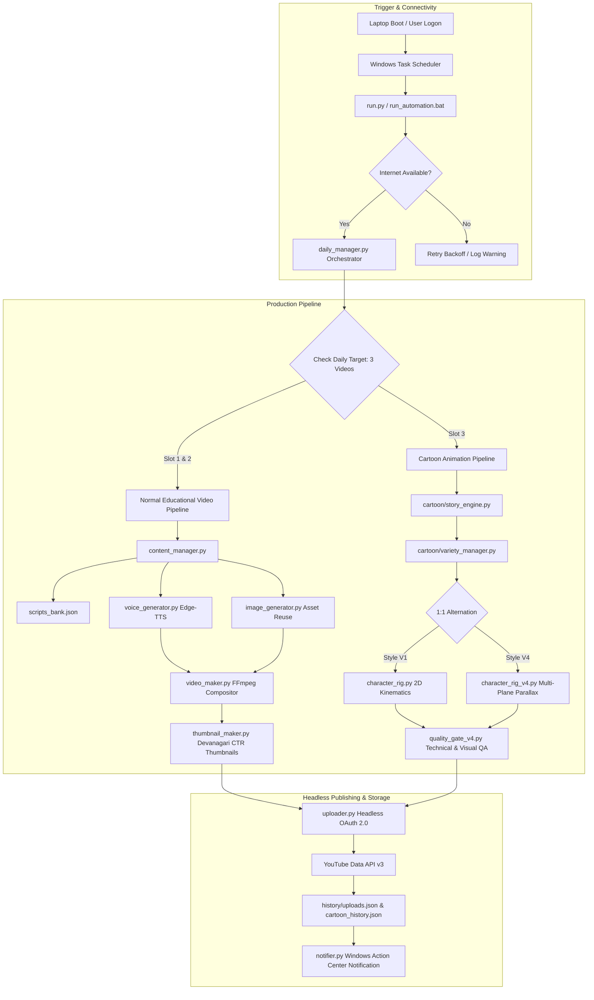

# Fun Learning Kids
## Autonomous YouTube Kids Content Generation & Publishing Platform

[](https://www.python.org/)
[](https://developers.google.com/youtube/v3)
[](https://ffmpeg.org/)
[](https://github.com/rany2/edge-tts)
[-orange)]()
[](LICENSE)

> An industrial-grade, fully autonomous content production and publishing engine that generates and publishes **3 distinct YouTube videos daily** (2 educational videos + 1 original cartoon animation episode) with zero manual intervention.

---

## Table of Contents
- [1. Executive Summary](#1-executive-summary)
- [2. System Architecture](#2-system-architecture)
- [3. Key Features](#3-key-features)
- [4. Dual-Track Production Pipelines](#4-dual-track-production-pipelines)
- [5. Original Cartoon Animation Engines (V1 & V4)](#5-original-cartoon-animation-engines-v1--v4)
- [6. Variety Manager & Anti-Repetition Model](#6-variety-manager--anti-repetition-model)
- [7. Headless OAuth 2.0 & YouTube API Engine](#7-headless-oauth-20--youtube-api-engine)
- [8. Technology Stack](#8-technology-stack)
- [9. Project Structure](#9-project-structure)
- [10. Quickstart & Developer Setup](#10-quickstart--developer-setup)
- [11. Local Dry-Run & Verification](#11-local-dry-run--verification)
- [12. Security & Disclaimer](#12-security--disclaimer)

---

## 1. Executive Summary

**Fun Learning Kids** was architected to solve the content cadence and production overhead challenges of running a daily children's educational YouTube channel. Instead of relying on manual scriptwriting, voice recording, manual video editing, and manual uploads, this system provides a resilient, headless software pipeline that:

1. **Detects Laptop Startup & Network State**: Automatically triggers upon Windows boot or scheduled intervals, verifying network connectivity with retry backoff.
2. **Generates High-Fidelity Multimedia**: Integrates neural Hindi speech synthesis, procedural 2D animation, and multi-track audio mastering.
3. **Enforces Content Variety & Quality**: Utilizes an anti-repetition engine to prevent recurring characters, locations, or story themes across consecutive days.
4. **Publishes Directly to YouTube**: Executes headless chunked uploads, applies high-CTR Devanagari thumbnails, sets COPPA Made-for-Kids compliance, and alerts the operator via native Windows Action Center notifications.

---

## 2. System Architecture



---

## 3. Key Features

- **Autonomous 3-Video Daily Output**: Fulfills a strict daily quota (Morning Educational + Evening Educational + Afternoon Cartoon Episode).
- **Dual Animation Engine Support**: Alternates seamlessly between lightweight Kinematic Vector animation (V1) and 1080p Multi-Plane Parallax animation (V4).
- **Strict 1:1 Engine Alternation**: Equal 50/50 distribution anchored persistently on confirmed YouTube uploads.
- **Content Variety & Anti-Repetition Rules**: Enforces consecutive character prohibitions, background rotations, thematic diversity, and character cooldown periods.
- **Headless OAuth 2.0 Lifecycle**: Zero-touch token refresh mechanism runs unattended without browser popups.
- **High-Quality Neural Audio**: Edge-TTS Hindi neural voices (`hi-IN-SwaraNeural`, `hi-IN-MadhurNeural`) with micro-fades and volume normalization (-1.0 dBFS).
- **Dynamic FFmpeg Subtitles**: Hardburned, high-legibility yellow subtitles with black outline positioned precisely for young viewers.
- **Automated Dual Quality Gate (QA)**: Validates 22 technical checkpoints (bitrate, resolution, sample rate, FPS) and 7 visual composition checkpoints before upload.
- **Failure Isolation**: Errors in the cartoon animation pipeline are cleanly captured and reported, ensuring educational videos are never blocked.
- **COPPA Compliance**: Automatic enforcement of `Made For Kids = True` and Category `27` (Education).

---

## 4. Dual-Track Production Pipelines

| Feature | Track 1: Normal Educational Videos | Track 2: Original Cartoon Episodes |
| :--- | :--- | :--- |
| **Output Slots** | Slot 1 (Morning, 09:00) & Slot 2 (Evening, 21:30) | Slot 3 (Cartoon Animation) |
| **Topics** | Moral Stories, Animal Facts, Good Habits, ABCs, Numbers | Curated 6-Scene Narrative Character Adventures |
| **Visual Method** | Smooth Ken-Burns camera movement on curated artwork | Kinematic skeletal rigs or 1080p Parallax multi-plane layers |
| **Audio Setup** | High-clarity neural narration with background music | Multi-character speech, synced mouth visemes, Foley effects |
| **Resolution** | 1280x720 @ 25 FPS (H.264 / AAC) | 1280x720 @ 30 FPS (H.264 / AAC) |
| **Subtitles** | English subtitles with bold yellow Devanagari styling | Synchronized bilingual subtitle tracks |

---

## 5. Original Cartoon Animation Engines (V1 & V4)

The cartoon production pipeline includes two independent animation engines:

### 5.1 Version 1 Engine — Kinematic Vector Animation
- **Rigging Engine (`cartoon/character_rig.py`)**: Hierarchical skeletal kinematics rendering limbs, ears, and heads with sinusoidal bounce, sway, and phoneme visemes.
- **Cast**: *Chintu Bunny*, *Golu Bear*, *Koko Squirrel*, *Bholu Puppy*, *Leo Lion Cub*.
- **Environments**: *Forest Meadow*, *Sunny Farm*, *Treehouse Canopy*, *Pond Park*.
- **Performance**: Lightweight, sub-second per frame render times.

### 5.2 Version 4 Engine — 1080p Multi-Plane Parallax Animation
- **Rigging Engine (`cartoon/character_rig_v4.py`)**:
  - **Look-At Gaze Tracking**: Active pupil targeting following interactive props, wheels, and camera.
  - **Feathered Ground Contact Shadows**: Radial gradient Gaussian-blurred shadows dynamically scaling with vertical elevation.
  - **Natural Acting Kinematics**: Deceleration into stops, anticipation crouching, and volume-preserving squash & stretch.
- **Compositor (`cartoon/scene_renderer_v4.py`)**: Multi-plane camera traveling across Far, Midground, and Foreground layers with depth-of-field blur.
- **Cast**: *Mimi Kitten*, *Bantu the Robot*, *Aarav the Explorer*, *Tara Kitten*.
- **Environments**: *Cozy Playroom*, *Little Science Lab*, *Starry Space*.

---

## 6. Variety Manager & Anti-Repetition Model

To eliminate viewer fatigue, [`cartoon/variety_manager.py`](cartoon/variety_manager.py) enforces 6 deterministic constraints:

```
┌────────────────────────────────────────────────────────────────────────┐
│                      ANTI-REPETITION CONSTRAINTS                       │
├────────────────────────────────────────────────────────────────────────┤
│ 1. Engine Cadence     : Strict 1:1 Alternation (Day 1=V1, Day 2=V4...) │
│ 2. Character Guard    : Main character cannot repeat on consecutive days│
│ 3. Mimi Cooldown      : Minimum 3-4 episode gap before Mimi can return │
│ 4. Environment Guard  : Background/Location must rotate each day       │
│ 5. Theme Diversity    : Moral theme cannot repeat on consecutive days  │
│ 6. Cryptographic Hash : Unique SHA-256 hash verified before upload     │
└────────────────────────────────────────────────────────────────────────┘
```

---

## 7. Headless OAuth 2.0 & YouTube API Engine

The upload engine ([`uploader.py`](uploader.py)) provides unattended YouTube Data API v3 publishing:

- **Token Persistence**: Tokens are stored in `token.json` containing the access token, expiration timestamp, and refresh token.
- **Automated Silent Refresh**: When an access token expires, `uploader.py` automatically exchanges the refresh token with Google's OAuth endpoint in memory and updates `token.json` without user interaction.
- **Chunked Resumable Uploads**: Uploads are performed using `MediaFileUpload` with chunked byte transfers for network resilience.
- **Deduplication Engine**: Video SHA-256 hashes and topic IDs are checked against [`history/uploads.json`](history/) to guarantee zero duplicate uploads.

---

## 8. Technology Stack

| Domain | Technology / Library | Purpose |
| :--- | :--- | :--- |
| **Language** | Python 3.10 / 3.11 / 3.12 | Core orchestration, pipelines, and character kinematics |
| **Speech Synthesis** | Microsoft Edge-TTS | Neural Hindi voices (`hi-IN-SwaraNeural`, `hi-IN-MadhurNeural`) |
| **Video Compositing** | FFmpeg (CLI & Pipe) | H.264 video encoding, AAC mixing, subtitle burning |
| **Image Processing** | Pillow (PIL) | Procedural sprite generation, rig transformations, thumbnails |
| **Array Computing** | NumPy & SciPy | Audio waveform normalization (-1.0 dBFS) and kinematic math |
| **Cloud Publishing** | Google API Client & OAuthLib | YouTube Data API v3 resumable video and thumbnail uploads |
| **Task Scheduling** | Windows Task Scheduler | On-boot logon trigger and scheduled cron execution |
| **Alerting** | PowerShell & Windows Action Center | Native desktop toast notifications for pipeline events |

---

## 9. Project Structure

```
Fun-Learning-Kids-Automation/
│
├── README.md                     # Comprehensive project documentation
├── LICENSE                       # Permissive MIT License
├── requirements.txt              # Pinned Python dependencies
├── config.example.py             # Safe configuration template
├── .env.example                  # Safe environment variables template
├── credentials.example.json      # OAuth 2.0 Client credentials template
├── .gitignore                    # Production secret & media quarantine
│
├── run.py                        # Master CLI entry point
├── daily_manager.py              # 3-video daily target coordinator
├── content_manager.py            # Educational script & topic rotation
├── voice_generator.py            # Edge-TTS voice generation & normalization
├── video_maker.py                # FFmpeg educational video compositor
├── thumbnail_maker.py            # Devanagari high-CTR thumbnail designer
├── image_generator.py            # Image asset management & reuse engine
├── uploader.py                   # Headless YouTube Data API v3 uploader
├── auth_setup.py                 # One-time interactive OAuth setup utility
├── notifier.py                   # Native Windows Action Center toast alerts
├── notifier.ps1                  # PowerShell toast notification backend
├── setup_tasks.ps1               # Windows Task Scheduler deployment script
├── uninstall_tasks.ps1           # Windows Task Scheduler removal script
├── run_automation.bat            # Portable shell execution wrapper
├── scripts_bank.json             # 100+ curated educational Hindi scripts
│
├── cartoon/                      # Independent Cartoon Animation Subsystem
│   ├── story_engine.py           # 12+ child-safe cartoon story repository
│   ├── cartoon_daily_runner.py   # Cartoon master pipeline orchestrator
│   ├── variety_manager.py        # Persistent 1:1 alternation & anti-repetition
│   ├── character_rig.py          # V1 vector kinematic rigging engine
│   ├── scene_renderer.py         # V1 scene compositor & camera moves
│   ├── character_rig_v4.py       # V4 multi-plane rig, gaze tracking & shadows
│   ├── scene_renderer_v4.py      # V4 1080p parallax compositor
│   ├── quality_gate_v4.py        # Dual technical & visual QA validator
│   ├── subtitles.py              # Subtitle SRT generator
│   └── config.py                 # Cartoon subsystem constants
│
├── docs/                         # In-Depth Engineering Documentation
│   ├── architecture.md           # Architectural specification & Mermaid diagrams
│   ├── workflow.md               # Complete execution lifecycle & failure recovery
│   └── setup.md                  # Developer installation & GCP onboarding
│
└── history/                      # Production history directory (.gitkeep tracked)
```

---

## 10. Quickstart & Developer Setup

1. **Clone the repository**:
   ```bash
   git clone https://github.com/your-username/fun-learning-kids-automation.git
   cd fun-learning-kids-automation
   ```

2. **Install dependencies**:
   ```bash
   pip install -r requirements.txt
   ```

3. **Verify FFmpeg**:
   Ensure `ffmpeg` is accessible on your system PATH (`ffmpeg -version`).

4. **Configure YouTube Credentials**:
   - Copy `credentials.example.json` to `credentials.json`.
   - Populate with your Google Cloud OAuth 2.0 Desktop Client credentials.
   - Run the one-time interactive authorization:
     ```bash
     python auth_setup.py
     ```
   - For detailed setup, see [docs/setup.md](docs/setup.md).

---

## 11. Local Dry-Run & Verification

The platform includes a zero-risk `--dry-run` mode that performs complete end-to-end asset generation, voice synthesis, video compositing, and QA inspection without contacting YouTube:

```bash
# Verify Morning Educational Video (Dry-Run)
python run.py --dry-run --slot morning --force

# Verify Cartoon Episode in Style V1 (Dry-Run)
python run.py --slot cartoon --style v1 --dry-run --force

# Verify Cartoon Episode in Style V4 (Dry-Run)
python run.py --slot cartoon --style v4 --dry-run --force
```

---

## 12. Security & Disclaimer

- **Secret Quarantine**: This repository strictly excludes `credentials.json`, `token.json`, API secrets, runtime logs, generated MP4 videos, and private upload histories via `.gitignore`.
- **Safe Templates**: All configuration files (`config.example.py`, `.env.example`, `credentials.example.json`) contain dummy placeholder values.
- **Disclaimer**: This codebase is provided as an engineering portfolio demonstration of autonomous YouTube automation and procedural animation. Ensure compliance with YouTube Community Guidelines and API Terms of Service when deploying for production channels.
