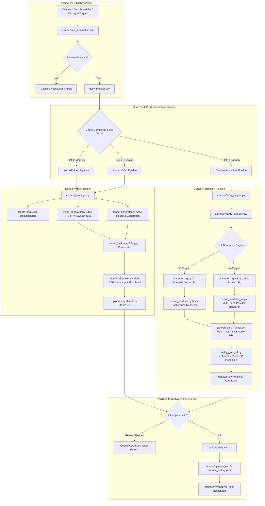
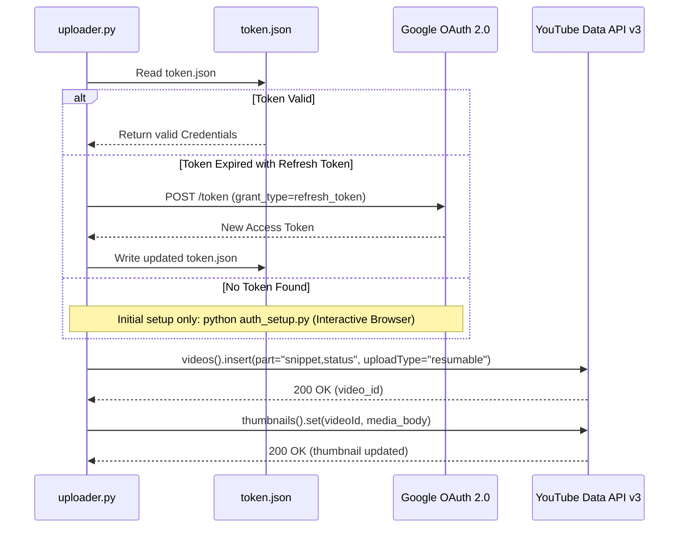

# System Architecture

## Fun Learning Kids — Automated YouTube Content Generation & Publishing System

This document provides a detailed architectural specification of the **Fun Learning Kids** automation platform. The platform is designed as an autonomous, dual-track content production pipeline capable of generating, rendering, and publishing educational and cartoon media to YouTube daily without human intervention.

---

## 1. High-Level Architecture

---

## 2. Dual-Track Architecture

The platform operates two isolated production tracks:

| Characteristic | Track A: Normal Educational Videos | Track B: Original Cartoon Episodes |
| :--- | :--- | :--- |
| **Daily Target** | 2 Videos (Morning Slot at 09:00, Evening Slot at 21:30) | 1 Video (Independent Cartoon Slot) |
| **Content Type** | Educational Stories (Moral stories, Animal facts, Good habits, ABCs, Numbers) | 6-Scene Narrative Character Cartoons |
| **Voice Engine** | Edge-TTS (`hi-IN-SwaraNeural`), Single narration stream | Multi-scene character & narrator dialogue, micro-fades, peak normalization (-1.0 dBFS) |
| **Visual Style** | Ken-Burns motion across curated high-res illustrations | Vector Kinematics (V1) or 1080p Multi-Plane Parallax with Contact Shadows (V4) |
| **Subtitle System** | Hardburned yellow subtitles with black border via FFmpeg filter | Synchronized English & Hindi subtitles with safe bottom-margin positioning |
| **Failure Isolation** | Isolated in `daily_manager.py` | Wrapped in self-contained `try/except` blocks; cartoon errors never halt educational videos |

---

## 3. Cartoon Animation Engines

The cartoon subsystem incorporates two distinct animation engines governed by a persistent **Strict 1:1 Alternation** controller:

### 3.1 Version 1 Engine (Kinematic Vector Animation)
- **Character Rigging (`character_rig.py`)**: Hierarchical skeletal kinematics for animal characters (*Chintu Bunny*, *Golu Bear*, *Koko Squirrel*, *Bholu Puppy*, *Leo Lion Cub*). Dynamic ear sways, limb rotation, and facial visemes.
- **Scene Renderer (`scene_renderer.py`)**: Dynamic viewport panning and zooming across vector backgrounds (`forest_meadow`, `sunny_farm`, `treehouse_canopy`, `pond_park`).
- **Compositing**: Direct rawvideo pipe into FFmpeg for rapid rendering at 25-30 FPS.

### 3.2 Version 4 Engine (1080p Multi-Plane Parallax)
- **Production Polish Rigging (`character_rig_v4.py`)**:
  - **Dynamic Gaze Tracking**: Active pupil look-at coordinates tracking interactive props and camera.
  - **Physical Contact Shadows**: Radial gradient Gaussian-blurred contact shadows dynamically scaling with character ground distance.
  - **Acting Sequences**: Anticipation crouching, squash & stretch volume preservation, and natural trotting deceleration.
- **Scene Renderer (`scene_renderer_v4.py`)**: Multi-plane parallax camera moving through Far, Midground, and Foreground layers (`cozy_playroom`, `science_lab`, `starry_space`).
- **Quality Gate (`quality_gate_v4.py`)**: Dual automated QA inspecting 22 technical checkpoints (resolution, audio rate, bitrates, duration) and 7 visual composition checkpoints.

---

## 4. Variety Manager & Anti-Repetition Engine

To prevent character, location, or thematic monotony, [`cartoon/variety_manager.py`](../cartoon/variety_manager.py) enforces 6 deterministic rules:

1. **Strict 1:1 Alternation**: Day 1 = V1, Day 2 = V4, Day 3 = V1, Day 4 = V4, maintaining 50/50 equal priority.
2. **Persistence Grounding**: Style rotation is determined strictly by the last confirmed YouTube upload record (`status == "uploaded"` with valid `video_id`). Rebooting or running in `--dry-run` mode never corrupts rotation state.
3. **No Consecutive Characters**: Yesterday's main character cannot be selected today.
4. **Mimi Cooldown**: Characters with heavy historical presence (e.g. Mimi) must observe a mandatory **3-4 episode gap** before reappearing.
5. **No Consecutive Backgrounds or Locations**: Environments alternate continuously (e.g., Treehouse $\to$ Lab $\to$ Farm $\to$ Space).
6. **Unique SHA-256 Video Hashes**: Every generated video is cryptographically hashed to verify uniqueness against historical outputs before upload.

---

## 5. Headless Authentication & Upload Security

- **Headless Execution**: The system runs unattended under Windows Task Scheduler using a persistent refresh token stored in `token.json`. No browser popups or user interactions occur during production runs.
- **COPPA Compliance**: All uploads programmatically specify `selfDeclaredMadeForKids=True` in YouTube metadata.
- **Category Enforcement**: Automatically categorizes videos under Category `27` (Education).
