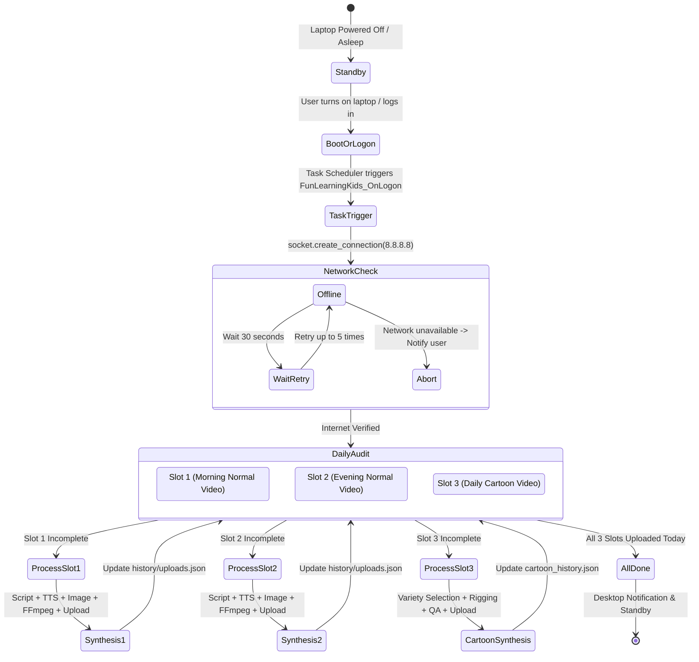
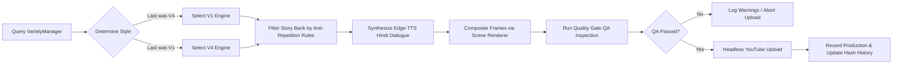

# Automation Lifecycle & Daily Workflow

## Fun Learning Kids — Complete Execution Lifecycle

This document explains the end-to-end execution lifecycle of the **Fun Learning Kids** automation system, covering startup detection, network validation, slot selection, asset synthesis, quality assurance, and YouTube upload.

---

## 1. Daily Orchestration Timeline



---

## 2. Trigger Mechanisms

The automation is configured with three redundant trigger mechanisms via Windows Task Scheduler:

1. **On Logon Trigger (`FunLearningKids_OnLogon`)**:
   - Fires whenever the user logs in or boots the laptop.
   - Configured with `StartWhenAvailable = True` and `RunOnBatteries = True`.
   - Guarantees that if the laptop was closed during scheduled hours, missed daily quotas are automatically caught up.
2. **Morning Schedule (`FunLearningKids_Morning`)**:
   - Daily trigger at **09:00 AM**.
   - Focuses on the primary educational morning video.
3. **Evening Schedule (`FunLearningKids_Evening`)**:
   - Daily trigger at **21:30 PM**.
   - Focuses on the evening educational video and checks cartoon status.

---

## 3. Slot Resolution & Execution Logic

When [`daily_manager.py`](../daily_manager.py) executes, it performs a slot-by-slot audit against `history/uploads.json` and `history/cartoon_history.json`:

```
Target: 3 Videos Daily
┌─────────────────────────────────────────────────────────────┐
│ 1. Video 1: Normal Educational Video (Morning)             │
│ 2. Video 2: Normal Educational Video (Evening)             │
│ 3. Video 3: Independent Kids Cartoon Episode (V1 / V4)      │
└─────────────────────────────────────────────────────────────┘
```

### 3.1 Idempotency & Duplicate Protection
- Before launching rendering, the system queries the upload history for the current date (`YYYY-MM-DD`).
- If an upload for that slot has already succeeded and possesses a valid `video_id`, generation is skipped.
- If an upload failed midway or network disconnected, the system safely resumes only the missing video(s).

---

## 4. Cartoon Video Execution Flow



1. **Style Determination**: Reads `cartoon_history.json`. If the last confirmed upload was V4, next is strictly V1 (and vice-versa).
2. **Story Selection**: Evaluates candidate stories against consecutive character, background, location, and visual theme constraints.
3. **Audio Synthesis**: Generates per-scene speech using Edge-TTS with micro-fades and volume normalization.
4. **Scene Rendering**: Animates characters, background layers, props, and camera movements.
5. **Quality Gate QA**: Validates audio bitrates, frame rates, subtitle timing, and visual composition.
6. **YouTube Upload**: Streams the final MP4 and custom thumbnail to YouTube via resumable chunked upload.
7. **Notification**: Dispatches a native Windows Action Center notification with the final video URL.
